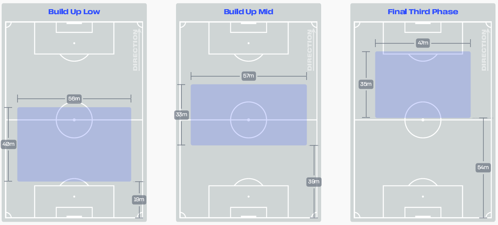
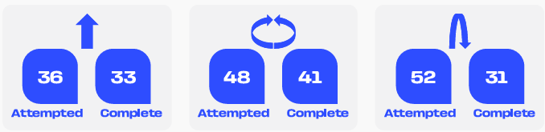
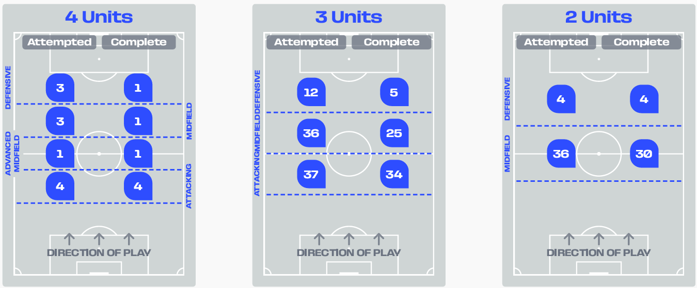
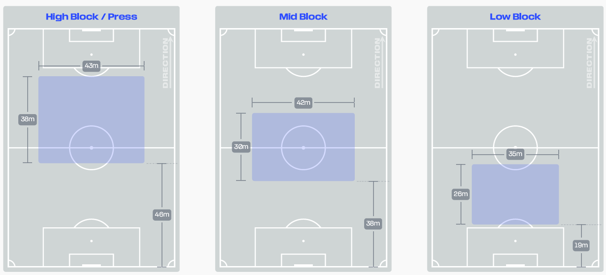

# Feature dictionary - `match_features.csv`

One row per team per match: home team first, away team second. The file has 135 columns: nation, match number, stage, 131 features and the result flag.
Column 1 is the nation name, column 2 the match number, column 3 the stage, column 135 the result flag.

All feature values are numeric. Integers are counts; floats are rounded to 2 decimals. Percentages are shares in 0-1. Line height and team length are fractions of the pitch dimensions (0-1). Physical distances are in kilometres; durations in seconds.

## Abbreviations

| Token | Expansion |
|---|---|
| `ip` | in possession |
| `def` | out of possession / defensive |
| `lh` | line height & team length |
| `lb` | line breaks |
| `gk` | goalkeeping |
| `sp` | set plays |
| `phys` | physical data |
| `xg` | expected goals |
| `pct` | percentage column; the value is stored as a share from 0 to 1 |
| `norm` | normalised by a pitch dimension (105 m length or 68 m width), 0-1 |
| `km` | kilometres |
| `m` | metres (pitch size only, in this dictionary) |
| `s` | seconds |
| `build up low` / `build up mid` | in-possession phases: build-up with a low / mid line |
| `final third` | in-possession final-third phase |
| `high block` / `mid block` / `low block` | out-of-possession block height |
| `units` | lines of the opposition shape (4, 3 or 2 units) |

Source page numbers are for a 52-page report. The Attempts at Goal section adds 0-2 pages depending on attempt volume, shifting every later section by the same amount.

## Columns

### Match identity

| # | Column | Type | Meaning | Unit |
|---|---|---|---|---|
| 1 | `nation` | str | Team nation, exactly as printed on the report cover. | - |
| 2 | `match_no` | int | Match number parsed from the PDF filename (M01 -> 1) | id |
| 3 | `stage` | str | Competition stage from the report folder: group stage or knock out | - |

### Match summary - key statistics (p. 3)

| # | Column | Type | Meaning | Unit |
|---|---|---|---|---|
| 4 | `possession_pct` | float | Ball possession as a share of match time, 0-1. The contested-possession figure printed between the two teams is not included, so home + away + contested = 1. | share (0-1) |
| 5 | `xg` | float | Expected goals (xG). | goals |
| 6 | `attempts_at_goal` | int | Total attempts at goal. | count |
| 7 | `total_passes` | int | Total passes attempted. | count |
| 8 | `pass_completion_pct` | float | Share of passes completed, 0-1. | share (0-1) |
| 9 | `completed_line_breaks` | int | Completed line breaks, all types. | count |
| 10 | `receptions_final_third` | int | Receptions in the final third. | count |
| 11 | `crosses_total` | int | Crosses in all situations: open play plus set plays. | count |
| 12 | `ball_progressions` | int | Ball progressions. | count |
| 13 | `second_balls` | int | Second balls. | count |

### In possession - line height & team length (pp. 6-7)

| # | Column | Type | Meaning | Unit |
|---|---|---|---|---|
| 14 | `ip_lh_buildup_low_vertical_distance_norm` | float | In possession, build-up, low: Vertical distance of the line from the team's own goal line, divided by 105 m | pitch length (0-1) |
| 15 | `ip_lh_buildup_low_block_length_norm` | float | In possession, build-up, low: Team block length, goal to goal, divided by 105 m | pitch length (0-1) |
| 16 | `ip_lh_buildup_low_block_width_norm` | float | In possession, build-up, low: Team block width, touchline to touchline, divided by 68 m | pitch width (0-1) |
| 17 | `ip_lh_buildup_mid_vertical_distance_norm` | float | In possession, build-up, mid: Vertical distance of the line from the team's own goal line, divided by 105 m | pitch length (0-1) |
| 18 | `ip_lh_buildup_mid_block_length_norm` | float | In possession, build-up, mid: Team block length, goal to goal, divided by 105 m | pitch length (0-1) |
| 19 | `ip_lh_buildup_mid_block_width_norm` | float | In possession, build-up, mid: Team block width, touchline to touchline, divided by 68 m | pitch width (0-1) |
| 20 | `ip_lh_final_third_vertical_distance_norm` | float | In possession, final third: Vertical distance of the line from the team's own goal line, divided by 105 m | pitch length (0-1) |
| 21 | `ip_lh_final_third_block_length_norm` | float | In possession, final third: Team block length, goal to goal, divided by 105 m | pitch length (0-1) |
| 22 | `ip_lh_final_third_block_width_norm` | float | In possession, final third: Team block width, touchline to touchline, divided by 68 m | pitch width (0-1) |

### In possession - line breaks (pp. 8-9)

| # | Column | Type | Meaning | Unit |
|---|---|---|---|---|
| 23 | `lb_through_attempted` | int | Line breaks attempted through the opposition line | count |
| 24 | `lb_through_completed` | int | Line breaks completed through the opposition line | count |
| 25 | `lb_around_attempted` | int | Line breaks attempted around the opposition line | count |
| 26 | `lb_around_completed` | int | Line breaks completed around the opposition line | count |
| 27 | `lb_over_attempted` | int | Line breaks attempted over the opposition line | count |
| 28 | `lb_over_completed` | int | Line breaks completed over the opposition line | count |
| 29 | `lb_4units_attempted` | int | Line breaks attempted across 4 units of the opposition shape | count |
| 30 | `lb_4units_inside_shape` | int | Line breaks across 4 units played inside the opposition shape | count |
| 31 | `lb_4units_outside_shape` | int | Line breaks across 4 units played outside the opposition shape | count |
| 32 | `lb_3units_attempted` | int | Line breaks attempted across 3 units of the opposition shape | count |
| 33 | `lb_3units_inside_shape` | int | Line breaks across 3 units played inside the opposition shape | count |
| 34 | `lb_3units_outside_shape` | int | Line breaks across 3 units played outside the opposition shape | count |
| 35 | `lb_2units_attempted` | int | Line breaks attempted across 2 units of the opposition shape | count |
| 36 | `lb_2units_inside_shape` | int | Line breaks across 2 units played inside the opposition shape | count |
| 37 | `lb_2units_outside_shape` | int | Line breaks across 2 units played outside the opposition shape | count |

### In possession - line break distribution by units (pp. 8-9)

The three bottom panels split the attempted line breaks by the line (unit) the break was played through. Rows run top to bottom: 4 Units = Defensive → Midfield → Advanced Midfield → Attacking; 3 Units = Defensive → Midfield → Attacking; 2 Units = Defensive → Midfield. Each line has an Attempted and a Completed count.

| # | Column | Type | Meaning | Unit |
|---|---|---|---|---|
| 38 | `lb_4units_defensive_attempted` | int | Line breaks across 4 units attempted through the defensive line | count |
| 39 | `lb_4units_defensive_completed` | int | Line breaks across 4 units completed through the defensive line | count |
| 40 | `lb_4units_midfield_attempted` | int | Line breaks across 4 units attempted through the midfield line | count |
| 41 | `lb_4units_midfield_completed` | int | Line breaks across 4 units completed through the midfield line | count |
| 42 | `lb_4units_advanced_midfield_attempted` | int | Line breaks across 4 units attempted through the advanced midfield line | count |
| 43 | `lb_4units_advanced_midfield_completed` | int | Line breaks across 4 units completed through the advanced midfield line | count |
| 44 | `lb_4units_attacking_attempted` | int | Line breaks across 4 units attempted through the attacking line | count |
| 45 | `lb_4units_attacking_completed` | int | Line breaks across 4 units completed through the attacking line | count |
| 46 | `lb_3units_defensive_attempted` | int | Line breaks across 3 units attempted through the defensive line | count |
| 47 | `lb_3units_defensive_completed` | int | Line breaks across 3 units completed through the defensive line | count |
| 48 | `lb_3units_midfield_attempted` | int | Line breaks across 3 units attempted through the midfield line | count |
| 49 | `lb_3units_midfield_completed` | int | Line breaks across 3 units completed through the midfield line | count |
| 50 | `lb_3units_attacking_attempted` | int | Line breaks across 3 units attempted through the attacking line | count |
| 51 | `lb_3units_attacking_completed` | int | Line breaks across 3 units completed through the attacking line | count |
| 52 | `lb_2units_defensive_attempted` | int | Line breaks across 2 units attempted through the defensive line | count |
| 53 | `lb_2units_defensive_completed` | int | Line breaks across 2 units completed through the defensive line | count |
| 54 | `lb_2units_midfield_attempted` | int | Line breaks across 2 units attempted through the midfield line | count |
| 55 | `lb_2units_midfield_completed` | int | Line breaks across 2 units completed through the midfield line | count |

For each panel, the per-line attempted values sum to `lb_4units_attempted`, `lb_3units_attempted` or `lb_2units_attempted`. The `inside_shape` / `outside_shape` columns split that same attempted total by location; they are not a split of the Completed values.

### In possession - attempts at goal (attempts summary page)

| # | Column | Type | Meaning | Unit |
|---|---|---|---|---|
| 56 | `attempts_goals` | int | Attempts that scored a goal | count |
| 57 | `attempts_on_target` | int | Attempts on target that did not score | count |
| 58 | `attempts_off_target` | int | Attempts off target | count |
| 59 | `attempts_blocked` | int | Attempts blocked | count |
| 60 | `attempts_incomplete` | int | Attempts with no shot outcome (incomplete) | count |

### In possession - crosses (open play) (pp. 18-19)

| # | Column | Type | Meaning | Unit |
|---|---|---|---|---|
| 61 | `crosses_open_play_attempted` | int | Open-play crosses attempted; set-play crosses are excluded | count |
| 62 | `crosses_inswing` | int | Open-play inswinging crosses | count |
| 63 | `crosses_outswing` | int | Open-play outswinging crosses | count |
| 64 | `crosses_driven` | int | Open-play driven crosses | count |
| 65 | `crosses_lofted` | int | Open-play lofted crosses | count |
| 66 | `crosses_cutback` | int | Open-play cutback crosses | count |
| 67 | `crosses_push_cross` | int | Open-play push crosses | count |

### In possession - offering to receive (pp. 20-21)

| # | Column | Type | Meaning | Unit |
|---|---|---|---|---|
| 68 | `offers_final_third` | int | Offers to receive made in the final third | count |
| 69 | `offers_middle_third` | int | Offers to receive made in the middle third | count |
| 70 | `offers_defensive_third` | int | Offers to receive made in the defensive third | count |
| 71 | `offers_received` | int | Total offers to receive that were received | count |
| 72 | `offers_inside_shape` | int | Offers to receive made inside the opposition shape | count |
| 73 | `offers_outside_shape` | int | Offers to receive made outside the opposition shape | count |

### In possession - movement to receive (pp. 22-23)

| # | Column | Type | Meaning | Unit |
|---|---|---|---|---|
| 74 | `movement_final_third_in_front` | int | Movement to receive in front of the opponent (final third) | count |
| 75 | `movement_final_third_in_between` | int | Movement to receive in between the lines (final third) | count |
| 76 | `movement_final_third_out_to_in` | int | Movement to receive from outside to inside (final third) | count |
| 77 | `movement_final_third_in_to_out` | int | Movement to receive from inside to outside (final third) | count |
| 78 | `movement_final_third_in_behind` | int | Movement to receive in behind the opponent (final third) | count |
| 79 | `movement_middle_third_in_front` | int | Movement to receive in front of the opponent (middle third) | count |
| 80 | `movement_middle_third_in_between` | int | Movement to receive in between the lines (middle third) | count |
| 81 | `movement_middle_third_out_to_in` | int | Movement to receive from outside to inside (middle third) | count |
| 82 | `movement_middle_third_in_to_out` | int | Movement to receive from inside to outside (middle third) | count |
| 83 | `movement_middle_third_in_behind` | int | Movement to receive in behind the opponent (middle third) | count |
| 84 | `movement_defensive_third_in_front` | int | Movement to receive in front of the opponent (defensive third) | count |
| 85 | `movement_defensive_third_in_between` | int | Movement to receive in between the lines (defensive third) | count |
| 86 | `movement_defensive_third_out_to_in` | int | Movement to receive from outside to inside (defensive third) | count |
| 87 | `movement_defensive_third_in_to_out` | int | Movement to receive from inside to outside (defensive third) | count |
| 88 | `movement_defensive_third_in_behind` | int | Movement to receive in behind the opponent (defensive third) | count |

### Out of possession - defensive actions (pp. 25-26)

| # | Column | Type | Meaning | Unit |
|---|---|---|---|---|
| 89 | `def_forced_turnovers` | int | Forced turnovers | count |
| 90 | `def_possession_regained` | int | Possession regains | count |
| 91 | `def_interceptions` | int | Interceptions | count |
| 92 | `def_tackles` | int | Tackles | count |
| 93 | `possession_actions_per_defensive_action` | float | Possession actions per defensive action (ratio) | - |
| 94 | `blocks_passes` | int | Blocks: passes blocked | count |
| 95 | `blocks_attempts_at_goal` | int | Blocks: attempts at goal blocked | count |
| 96 | `blocks_crosses` | int | Blocks: crosses blocked | count |
| 97 | `blocks_clearances` | int | Blocks: clearances | count |
| 98 | `duels_physical` | int | Possession contests: physical duels | count |
| 99 | `duels_aerial` | int | Possession contests: aerial duels | count |
| 100 | `duels_total` | int | Possession contests: the segment labelled "Duels" (not the sum of physical + aerial) | count |

### Out of possession - defensive line height & team length (pp. 27-28)

| # | Column | Type | Meaning | Unit |
|---|---|---|---|---|
| 101 | `def_lh_high_block_vertical_distance_norm` | float | Out of possession, high block / press: Vertical distance of the line from the team's own goal line, divided by 105 m | pitch length (0-1) |
| 102 | `def_lh_high_block_length_norm` | float | Out of possession, high block / press: Team block length, goal to goal, divided by 105 m | pitch length (0-1) |
| 103 | `def_lh_high_block_width_norm` | float | Out of possession, high block / press: Team block width, touchline to touchline, divided by 68 m | pitch width (0-1) |
| 104 | `def_lh_mid_block_vertical_distance_norm` | float | Out of possession, mid block: Vertical distance of the line from the team's own goal line, divided by 105 m | pitch length (0-1) |
| 105 | `def_lh_mid_block_length_norm` | float | Out of possession, mid block: Team block length, goal to goal, divided by 105 m | pitch length (0-1) |
| 106 | `def_lh_mid_block_width_norm` | float | Out of possession, mid block: Team block width, touchline to touchline, divided by 68 m | pitch width (0-1) |
| 107 | `def_lh_low_block_vertical_distance_norm` | float | Out of possession, low block: Vertical distance of the line from the team's own goal line, divided by 105 m | pitch length (0-1) |
| 108 | `def_lh_low_block_length_norm` | float | Out of possession, low block: Team block length, goal to goal, divided by 105 m | pitch length (0-1) |
| 109 | `def_lh_low_block_width_norm` | float | Out of possession, low block: Team block width, touchline to touchline, divided by 68 m | pitch width (0-1) |

### Out of possession - defensive pressure (p. 29)

| # | Column | Type | Meaning | Unit |
|---|---|---|---|---|
| 110 | `pressures_total` | int | Total pressures applied | count |
| 111 | `pressures_direct` | int | Direct pressures | count |
| 112 | `pressure_avg_duration_s` | float | Average pressure duration | s |
| 113 | `ball_recovery_time_s` | float | Ball recovery time | s |
| 114 | `pushing_on_into_pressing` | int | Pushing on into pressing | count |
| 115 | `pushing_on` | int | Pushing on | count |
| 116 | `pressing_direction_inside` | int | Pressures with pressing direction inside | count |
| 117 | `pressing_direction_outside` | int | Pressures with pressing direction outside | count |

### Goalkeeping (pp. 34-37)

| # | Column | Type | Meaning | Unit |
|---|---|---|---|---|
| 118 | `gk_attempts_faced` | int | Attempts faced by the goalkeeper | count |
| 119 | `gk_save_pct` | float | Goalkeeper save percentage, 0-1 | share (0-1) |
| 120 | `aerial_interventions` | int | Aerial interventions by the goalkeeper | count |

### Set plays (pp. 39-40)

| # | Column | Type | Meaning | Unit |
|---|---|---|---|---|
| 121 | `set_plays_free_kicks` | int | Free kicks | count |
| 122 | `set_plays_penalties` | int | Penalties | count |
| 123 | `set_plays_corners` | int | Corners | count |
| 124 | `set_plays_corner_inswing` | int | Inswinging corners | count |
| 125 | `set_plays_corner_outswing` | int | Outswinging corners | count |
| 126 | `set_plays_throw_ins` | int | Throw-ins | count |

### Individual data - physical (pp. 50-51)

| # | Column | Type | Meaning | Unit |
|---|---|---|---|---|
| 127 | `physical_total_distance_km` | float | Total distance covered, summed over the players listed | km |
| 128 | `physical_zone1_0_7_km` | float | Distance in speed zone 1: 0-7 km/h | km |
| 129 | `physical_zone2_7_15_km` | float | Distance in speed zone 2: 7-15 km/h | km |
| 130 | `physical_zone3_15_20_km` | float | Distance in speed zone 3: 15-20 km/h | km |
| 131 | `physical_zone4_20_25_km` | float | Distance in speed zone 4: 20-25 km/h | km |
| 132 | `physical_zone5_25_plus_km` | float | Distance in speed zone 5: 25+ km/h | km |
| 133 | `physical_high_speed_runs` | float | High-speed runs | count |
| 134 | `physical_sprints` | float | Sprints | count |

### Result (cover)

| # | Column | Type | Meaning | Unit |
|---|---|---|---|---|
| 135 | `win` | float | Result: 1 win, 0.5 draw (level after 120 minutes), 0 loss | flag |
