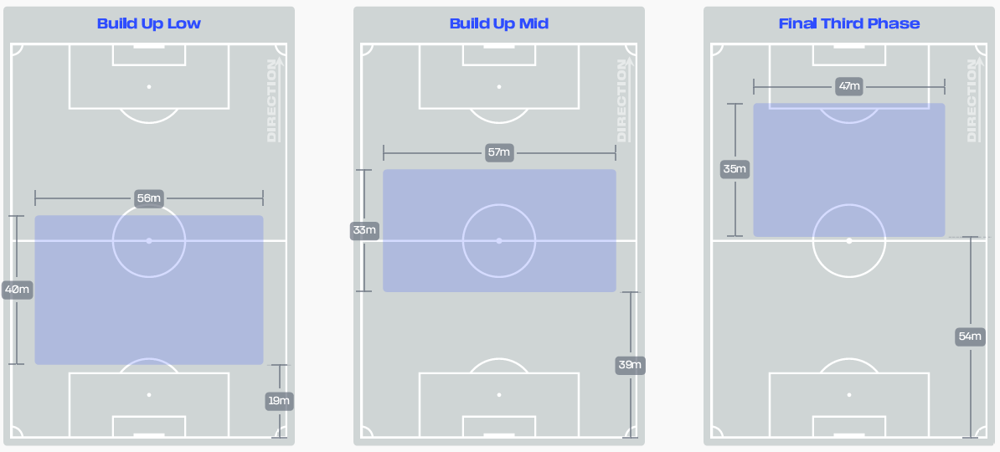
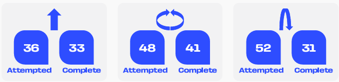
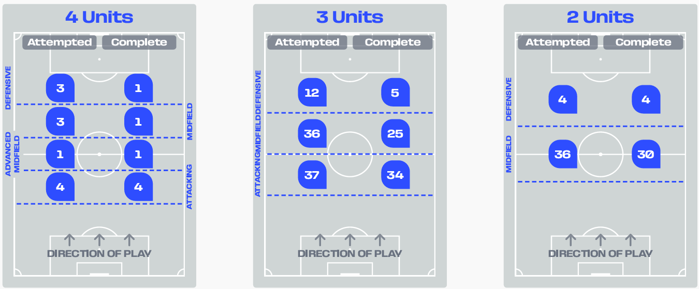
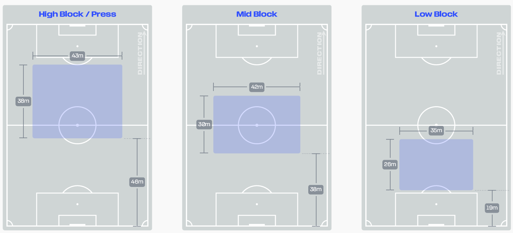

# 世界杯比赛特征说明

- 百分比数据以 0–1 的小数表示；line height 与球队长度按场地尺寸归一化到 0–1（105 m 长度、68 m 宽度）；体能距离单位为千米（km），时间单位为秒（s）。
- 比赛结果按照三分类进行标签：胜，平，负

## 比赛摘要 — 关键统计（第 3 页）

| # | 特征 | 含义 |
|---:|---|---|
| 4 | `控球率` | 控球时间占比赛时间的比例。 |
|  | **对比赛结果的影响** |  |
| 5 | `预期进球` |  |
|  | **对比赛结果的影响** |  |
| 6 | `射门尝试数。` |  |
|  | **对比赛结果的影响** |  |
| 7 | `传球尝试数。` |  |
|  | **对比赛结果的影响** |  |
| 8 | `传球成功率` |  |
|  | **对比赛结果的影响** |  |
| 9 | `completed_line_breaks` | 完成的 line breaks 总数（所有类型）。 |
|  | **对比赛结果的影响** |  |
| 10 | `进攻三区接球次数` |  |
|  | **对比赛结果的影响** |  |
| 11 | `传中` |  |
|  | **对比赛结果的影响** |  |
| 12 | `持球推进次数`  |  |
|  | **对比赛结果的影响** |  |
| 13 | `第二落点球` | 争抢到第二落点球次数。 |
|  | **对比赛结果的影响** |  |

## 控球时 — 球队高度与长度（第 6–7 页）

| # | 特征 | 含义 |
|---:|---|---|
| 14 | `build up low区域距离` | 球队build up low区域距本方球门线的垂直距离。 |
|  | **对比赛结果的影响** |  |
| 15 | `build up low区域长度` | 球队build up low区域长度（垂直）。 |
|  | **对比赛结果的影响** |  |
| 16 | `build up low区域宽度` | 球队build up low区域宽度（水平）。 |
|  | **对比赛结果的影响** |  |
| 17 | `build up mid区域距离` | 球队build up mid区域距本方球门线的垂直距离。 |
|  | **对比赛结果的影响** |  |
| 18 | `build up mid区域长度` | 球队build up mid区域长度（垂直）。 |
|  | **对比赛结果的影响** |  |
| 19  | `build up mid区域宽度` | 球队build up mid区域宽度（水平）。 |
|  | **对比赛结果的影响** |  |
| 20 | `final third phase区域距离` | 球队final third phase区域距本方球门线的垂直距离。 |
|  | **对比赛结果的影响** |  |
| 21 | `final third phase区域长度` | 球队final third phase区域长度（垂直）。 |
|  | **对比赛结果的影响** |  |
| 22 | `final third phase区域宽度` | 球队final third phase区域长度（水平）。 |
|  | **对比赛结果的影响** |  |

## 控球时 — 防线突破 Line Break（第 8–9 页）

| # | 特征 | 含义 |
|---:|---|---|
| 23 | `地面向前防线越过次数` | 尝试从地面对手防线中穿过的 line breaks 次数。（如上图左小图所示） |
|  | **对比赛结果的影响** |  |
| 24 | `地面向前防线越过成功次数` | 完成从地面穿过对手防线的 line breaks 次数。（如上图左小图所示） |
|  | **对比赛结果的影响** |  |
| 25 | `两侧防线越过次数` | 尝试从对手防线外侧绕过的 line breaks 次数。（如上图中间小图所示） |
|  | **对比赛结果的影响** |  |
| 26 | `两侧防线越过成功次数` | 完成绕过对手防线的 line breaks 次数。（如上图中间小图所示） |
|  | **对比赛结果的影响** |  |
| 27 | `上方越过防线次数` | 尝试从对手防线上方越过的 line breaks 次数。（如上图右小图所示） |
|  | **对比赛结果的影响** |  |
| 28 | `上方越过防线成功次数` | 完成从上方越过对手防线的 line breaks 次数。（如上图右小图所示） |
|  | **对比赛结果的影响** |  |

| # | 特征 | 含义 |
|---:|---|---|
| 29 | `4层防线突破尝试次数` | 尝试跨越对手 4 units（4层防线）的 line breaks 次数。（如上图 4 Units 面板所示） |
|  | **对比赛结果的影响** |  |
| 30 | `4层防线内部突破次数` | 在对手阵型内部跨越 4 units（4层防线）的 line breaks 次数。（如上图 4 Units 面板所示） |
|  | **对比赛结果的影响** |  |
| 31 | `4层防线外部突破次数` | 在对手阵型外部跨越 4 units（4层防线）的 line breaks 次数。（如上图 4 Units 面板所示） |
|  | **对比赛结果的影响** |  |
| 32 | `3层防线突破尝试次数` | 尝试跨越对手 3 units（3层防线）的 line breaks 次数。（如上图 3 Units 面板所示） |
|  | **对比赛结果的影响** |  |
| 33 | `3层防线内部突破次数` | 在对手阵型内部跨越 3 units（3层防线）的 line breaks 次数。（如上图 3 Units 面板所示） |
|  | **对比赛结果的影响** |  |
| 34 | `3层防线外部突破次数` | 在对手阵型外部跨越 3 units（3层防线）的 line breaks 次数。（如上图 3 Units 面板所示） |
|  | **对比赛结果的影响** |  |
| 35 | `2层防线突破尝试次数` | 尝试跨越对手 2 units（2层防线）的 line breaks 次数。（如上图 2 Units 面板所示） |
|  | **对比赛结果的影响** |  |
| 36 | `2层防线内部突破次数` | 在对手阵型内部跨越 2 units（2层防线）的 line breaks 次数。（如上图 2 Units 面板所示） |
|  | **对比赛结果的影响** |  |
| 37 | `2层防线外部突破次数` | 在对手阵型外部跨越 2 units（2层防线）的 line breaks 次数。（如上图 2 Units 面板所示） |
|  | **对比赛结果的影响** |  |

## 控球时 — 各防线层级的突破分布（第 8–9 页）

- 4 Units 面板从上到下依次为：防守线（DEFENSIVE）→ 中场线（MIDFIELD）→ 进攻中场线（ADVANCED MIDFIELD）→ 进攻线（ATTACKING）。
- 3 Units 面板从上到下依次为：防守线 → 中场线 → 进攻线。
- 2 Units 面板从上到下依次为：防守线 → 中场线。
- 每个层级对应图表中的两个计数：Attempted（尝试）与 Completed（成功）。

| # | 特征 | 含义 |
|---:|---|---|
| 38 | `4层防线防守线尝试次数` | 4 Units 面板中，突破防守线（DEFENSIVE）的尝试次数。 |
|  | **对比赛结果的影响** |  |
| 39 | `4层防线防守线成功次数` | 4 Units 面板中，突破防守线（DEFENSIVE）的成功次数。 |
|  | **对比赛结果的影响** |  |
| 40 | `4层防线中场线尝试次数` | 4 Units 面板中，突破中场线（MIDFIELD）的尝试次数。 |
|  | **对比赛结果的影响** |  |
| 41 | `4层防线中场线成功次数` | 4 Units 面板中，突破中场线（MIDFIELD）的成功次数。 |
|  | **对比赛结果的影响** |  |
| 42 | `4层防线进攻中场线尝试次数` | 4 Units 面板中，突破进攻中场线（ADVANCED MIDFIELD）的尝试次数。 |
|  | **对比赛结果的影响** |  |
| 43 | `4层防线进攻中场线成功次数` | 4 Units 面板中，突破进攻中场线（ADVANCED MIDFIELD）的成功次数。 |
|  | **对比赛结果的影响** |  |
| 44 | `4层防线进攻线尝试次数` | 4 Units 面板中，突破进攻线（ATTACKING）的尝试次数。 |
|  | **对比赛结果的影响** |  |
| 45 | `4层防线进攻线成功次数` | 4 Units 面板中，突破进攻线（ATTACKING）的成功次数。 |
|  | **对比赛结果的影响** |  |
| 46 | `3层防线防守线尝试次数` | 3 Units 面板中，突破防守线（DEFENSIVE）的尝试次数。 |
|  | **对比赛结果的影响** |  |
| 47 | `3层防线防守线成功次数` | 3 Units 面板中，突破防守线（DEFENSIVE）的成功次数。 |
|  | **对比赛结果的影响** |  |
| 48 | `3层防线中场线尝试次数` | 3 Units 面板中，突破中场线（MIDFIELD）的尝试次数。 |
|  | **对比赛结果的影响** |  |
| 49 | `3层防线中场线成功次数` | 3 Units 面板中，突破中场线（MIDFIELD）的成功次数。 |
|  | **对比赛结果的影响** |  |
| 50 | `3层防线进攻线尝试次数` | 3 Units 面板中，突破进攻线（ATTACKING）的尝试次数。 |
|  | **对比赛结果的影响** |  |
| 51 | `3层防线进攻线成功次数` | 3 Units 面板中，突破进攻线（ATTACKING）的成功次数。 |
|  | **对比赛结果的影响** |  |
| 52 | `2层防线防守线尝试次数` | 2 Units 面板中，突破防守线（DEFENSIVE）的尝试次数。 |
|  | **对比赛结果的影响** |  |
| 53 | `2层防线防守线成功次数` | 2 Units 面板中，突破防守线（DEFENSIVE）的成功次数。 |
|  | **对比赛结果的影响** |  |
| 54 | `2层防线中场线尝试次数` | 2 Units 面板中，突破中场线（MIDFIELD）的尝试次数。 |
|  | **对比赛结果的影响** |  |
| 55 | `2层防线中场线成功次数` | 2 Units 面板中，突破中场线（MIDFIELD）的成功次数。 |
|  | **对比赛结果的影响** |  |

说明：每个面板中各防线层级的尝试次数之和，等于对应的 `lb_4units_attempted`、`lb_3units_attempted` 或 `lb_2units_attempted`。`inside_shape` / `outside_shape` 是对同一尝试总数的位置拆分，并不是对成功次数的拆分。

## 控球时 — 射门尝试

| # | 特征 | 含义 |
|---:|---|---|
| 56 | `进球` |  |
|  | **对比赛结果的影响** |  |
| 57 | `射正` | 射正但未进球的射门次数。 |
|  | **对比赛结果的影响** |  |
| 58 | `射偏` | 射偏的射门次数。 |
|  | **对比赛结果的影响** |  |
| 59 | `被封堵射门` | 被封堵的射门次数。 |
|  | **对比赛结果的影响** |  |
| 60 | `未完成射门` | 没有形成射门的次数。 |
|  | **对比赛结果的影响** |  |

## 控球时 — 传中（open play，不包含定位球 第 18–19 页）

| # | 特征 | 含义 |
|---:|---|---|
| 61 | `传中` | 传中尝试次数。 |
|  | **对比赛结果的影响** |  |
| 62 | `inswing传中` | 内旋（球趋近球门）传中次数。 |
|  | **对比赛结果的影响** |  |
| 63 | `outswing传中` | 外旋（球远离球门）传中次数。 |
|  | **对比赛结果的影响** |  |
| 64 | `低平传中` |  低平传中次数。 |
|  | **对比赛结果的影响** |  |
| 65 | `高吊传中` | 高吊传中次数。 |
|  | **对比赛结果的影响** |  |
| 66 | `cutback传中` |  倒三角回传次数。 |
|  | **对比赛结果的影响** |  |
| 67 | `扫传传中` | 推传次数。 |
|  | **对比赛结果的影响** |  |

## 控球时 — 接应要球（第 20–21 页）

| # | 特征 | 含义 |
|---:|---|---|
| 68 | `final third接应` | 在进攻三区接应要球次数。 |
|  | **对比赛结果的影响** |  |
| 69 | `middle third接应` | 在中场三区接应要球次数。 |
|  | **对比赛结果的影响** |  |
| 70 | `defensive third接应` | 在防守三区接应要球次数。 |
|  | **对比赛结果的影响** |  |
| 71 | `要球接应次数` | 接应要球成功总数。 |
|  | **对比赛结果的影响** |  |
| 72 | `阵型内部接应要球` | 在对手阵型内部做出的接应要球次数。 |
|  | **对比赛结果的影响** |  |
| 73 | `阵型外部接应要球` | 在对手阵型外部做出的接应要球次数。 |
|  | **对比赛结果的影响** |  |

## 控球时 — 接球跑动（第 22–23 页）

| # | 特征 | 含义 |
|---:|---|---|
| 74 | `final third防线前跑位` | 进攻三区内在对手身前接球的跑动次数。 |
|  | **对比赛结果的影响** |  |
| 75 | `final_third防线间跑位` | 进攻三区内在防线之间接球的跑动次数。 |
|  | **对比赛结果的影响** |  |
| 76 | `final_third向内部跑位` | 进攻三区内由阵型外部向内部接球的跑动次数。 |
|  | **对比赛结果的影响** |  |
| 77 | `final_third向外部跑位` | 进攻三区内由阵型内部向外部接球的跑动次数。 |
|  | **对比赛结果的影响** |  |
| 78 | `final_third防线后跑位` | 进攻三区内在对手身后接球的跑动次数。 |
|  | **对比赛结果的影响** |  |
| 79 | `middle third向前移动` | 中场三区内在对手身前接球的跑动次数。 |
|  | **对比赛结果的影响** |  |
| 80 | `middle third防线间跑位` | 中场三区内在防线之间接球的跑动次数。 |
|  | **对比赛结果的影响** |  |
| 81 | `middle third向内部跑位` | 中场三区内由阵型外部向内部接球的跑动次数。 |
|  | **对比赛结果的影响** |  |
| 82 | `middle third向外部跑位` | 中场三区内由阵型内部向外部接球的跑动次数。 |
|  | **对比赛结果的影响** |  |
| 83 | `middle third防线后跑位` | 中场三区内在对手身后接球的跑动次数。 |
|  | **对比赛结果的影响** |  |
| 84 | `defensive third向前移动` | 防守三区内在对手身前接球的跑动次数。 |
|  | **对比赛结果的影响** |  |
| 85 | `defensive third防线间跑位` | 防守三区内在防线之间接球的跑动次数。 |
|  | **对比赛结果的影响** |  |
| 86 | `defensive third向内部跑位` | 防守三区内由阵型外部向内部接球的跑动次数。 |
|  | **对比赛结果的影响** |  |
| 87 | `defensive third向外部跑位` | 防守三区内由阵型内部向外部接球的跑动次数。 |
|  | **对比赛结果的影响** |  |
| 88 | `defensive third防线后跑位` | 防守三区内在对手身后接球的跑动次数。 |
|  | **对比赛结果的影响** |  |

## 失球权时 — 防守动作（第 25–26 页）

| # | 特征 | 含义 |
|---:|---|---|
| 89 | `压迫夺回球权` | 使对手受迫性失误夺回球权次数。 |
|  | **对比赛结果的影响** |  |
| 90 | `球权夺回` | 夺回球权次数。 |
|  | **对比赛结果的影响** |  |
| 91 | `拦截` |  |
|  | **对比赛结果的影响** |  |
| 92 | 抢断   |   |
|  | **对比赛结果的影响** |  |
| 93 | `控球动作与防守动作比例` | 控球动作数/防守动作数。 |
|  | **对比赛结果的影响** |  |
| 94 | `封堵传球` | 封堵传球次数。 |
|  | **对比赛结果的影响** |  |
| 95 | `封堵射门` | 封堵射门次数。 |
|  | **对比赛结果的影响** |  |
| 96 | `封堵传中` | 封堵传中次数。 |
|  | **对比赛结果的影响** |  |
| 97 | `封堵解围` | 解围次数。 |
|  | **对比赛结果的影响** |  |
| 98 | `身体对抗` | 身体对抗次数。 |
|  | **对比赛结果的影响** |  |
| 99 | `空中对抗` | 空中对抗次数。 |
|  | **对比赛结果的影响** |  |
| 100 | `1对1对抗` | 1对1对抗次数。 |
|  | **对比赛结果的影响** |  |

## 无球权时 — 防线高度与球队长度（第 27–28 页）

| # | 特征 | 含义 |
|---:|---|---|
| 101 | `high_block垂直距离` | 球队high block距本方球门线的垂直距离。 |
|  | **对比赛结果的影响** |  |
| 102 | `high_block长度` | 球队high block区域长度（垂直）。 |
|  | **对比赛结果的影响** |  |
| 103 | `high_block宽度` | 球队high block区域宽度（水平）。 |
|  | **对比赛结果的影响** |  |
| 104 | `mid_block垂直距离` | 球队mid block距本方球门线的垂直距离。 |
|  | **对比赛结果的影响** |  |
| 105 | `mid_block长度` | 球队mid block区域长度（垂直）。 |
|  | **对比赛结果的影响** |  |
| 106 | `mid_block宽度` | 球队mid block区域宽度（水平）。 |
|  | **对比赛结果的影响** |  |
| 107 | `low_block垂直距离` | 球队low block距本方球门线的垂直距离。 |
|  | **对比赛结果的影响** |  |
| 108 | `low_block长度` | 球队low block区域长度（垂直）。 |
|  | **对比赛结果的影响** |  |
| 109 | `low_block宽度` | low block区域宽度（水平）。 |
|  | **对比赛结果的影响** |  |

## 失球权时 — 防守施压（第 29 页）

| # | 特征 | 含义 |
|---:|---|---|
| 110 | `施压` | 施压（pressures）总次数。 |
|  | **对比赛结果的影响** |  |
| 111 | `直接施压` | 直接施压（direct pressures）次数。 |
|  | **对比赛结果的影响** |  |
| 112 | `施压平均时长` | 平均施压持续时间，单位秒。 |
|  | **对比赛结果的影响** |  |
| 113 | `球权回复时间` | 球权恢复时间（ball recovery time），单位秒。 |
|  | **对比赛结果的影响** |  |
| 114 | `前顶逼抢` | 提前上抢并实施压迫的次数。 |
|  | **对比赛结果的影响** |  |
| 115 | `提前上抢` | 向前压上次数。 |
|  | **对比赛结果的影响** |  |
| 116 | `向内线施压` | 封锁边路，把对手赶向中路的次数。 |
|  | **对比赛结果的影响** |  |
| 117 | `向外线施压` | 封锁中路，把对手赶向边线的次数。 |
|  | **对比赛结果的影响** |  |

## 守门（第 34–37 页）

| # | 特征 | 含义 |
|---:|---|---|
| 118 | `面对射门数` |  |
|  | **对比赛结果的影响** |  |
| 119 | `扑救成功率` |  |
|  | **对比赛结果的影响** |  |
| 120 | `高空球干预` | 门将空中出击或摘球次数。 |
|  | **对比赛结果的影响** |  |

## 定位球（第 39–40 页）

| # | 特征 | 含义 |
|---:|---|---|
| 121 | `任意球` |  |
|  | **对比赛结果的影响** |  |
| 122 | `点球` |  |
|  | **对比赛结果的影响** |  |
| 123 | `角球` |  |
|  | **对比赛结果的影响** |  |
| 124 | `角球内旋` |  |
|  | **对比赛结果的影响** |  |
| 125 | `角球外旋` |  |
|  | **对比赛结果的影响** |  |
| 126 | `界外球` |  |
|  | **对比赛结果的影响** |  |

## 个人数据 — 体能（第 50–51 页）

| # | 特征 | 含义 |
|---:|---|---|
| 127 | `跑动距离` | 球员总跑动距离。 |
|  | **对比赛结果的影响** |  |
| 128 | `速度区间1跑动距离` | 速度区间1（0–7 km/h）的跑动距离。 |
|  | **对比赛结果的影响** |  |
| 129 | `速度区间2跑动距离` | 速度区间2（7–15 km/h）的跑动距离。 |
|  | **对比赛结果的影响** |  |
| 130 | `速度区间3跑动距离` | 速度区间3（15–20 km/h）的跑动距离。 |
|  | **对比赛结果的影响** |  |
| 131 | `速度区间4跑动距离` | 速度区间4（20–25 km/h）的跑动距离。 |
|  | **对比赛结果的影响** |  |
| 132 | `速度区间5跑动距离` | 速度区间5（25+ km/h）的跑动距离。 |
|  | **对比赛结果的影响** |  |
| 133 | `高速跑动次数` | 高速跑动（速度区间3）次数。 |
|  | **对比赛结果的影响** |  |
| 134 | `冲刺跑动次数` | 冲刺（速度区间4和5）次数。 |
|  | **对比赛结果的影响** |  |
